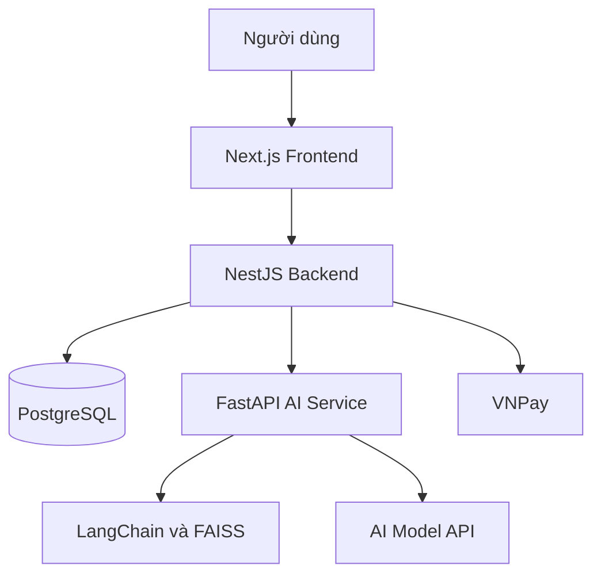

# Đồ án tốt nghiệp: Xây dựng website du lịch thông minh – JourniTrip

JourniTrip là nền tảng du lịch trực tuyến tích hợp trí tuệ nhân tạo (AI), hỗ trợ người dùng tìm kiếm, lựa chọn và đặt tour du lịch, đồng thời hỗ trợ doanh nghiệp quản lý và vận hành dịch vụ.

## Mục lục

- [Giới thiệu](#giới-thiệu)
- [Kiến trúc hệ thống](#kiến-trúc-hệ-thống)
- [Công nghệ sử dụng](#công-nghệ-sử-dụng)
- [Hướng dẫn cài đặt](#hướng-dẫn-cài-đặt)
- [Hướng dẫn chạy chương trình](#hướng-dẫn-chạy-chương-trình)
- [Cấu trúc thư mục](#cấu-trúc-thư-mục)

## Giới thiệu

Dự án kết hợp các chức năng của website thương mại điện tử du lịch với AI nhằm nâng cao trải nghiệm tìm kiếm và lựa chọn tour.

- **Khách hàng:** tìm kiếm, đặt tour, thanh toán VNPay, quản lý đơn đặt tour, ưu đãi, hội viên và đánh giá.
- **Quản trị:** quản lý tour, lịch khởi hành, đơn đặt tour, khách hàng, nhân sự, dịch vụ, nội dung và thống kê.
- **Trí tuệ nhân tạo:** chatbot tư vấn du lịch, gợi ý tour, so sánh tour, tìm kiếm bằng hình ảnh và thử trang phục du lịch ảo (Virtual Try-On).

## Kiến trúc hệ thống

Dự án được tổ chức theo mô hình monorepo với ba ứng dụng chính:

1. **Frontend (Next.js):** giao diện khách hàng và trang quản trị.
2. **Backend (NestJS):** xử lý nghiệp vụ, xác thực, đặt tour, thanh toán và giao tiếp thời gian thực.
3. **AI Service (FastAPI):** xử lý các chức năng AI, kết hợp LangChain, FAISS và API mô hình AI.



## Công nghệ sử dụng

- **Frontend:** Next.js 15, React 19, TypeScript, Tailwind CSS 4.
- **Backend:** NestJS 11, JWT, Socket.IO.
- **Database:** PostgreSQL, Prisma 6.
- **AI:** Python, FastAPI, LangChain, FAISS, API tương thích OpenAI.
- **Tích hợp:** VNPay, Google OAuth, Google Maps, Cloudinary, SMTP.
- **Monorepo:** npm Workspaces, Turborepo.

## Hướng dẫn cài đặt

### 1. Yêu cầu

- Git, Node.js 22 LTS trở lên, npm 11.5.2.
- Python 3.11 trở lên, pip và venv.
- PostgreSQL.

### 2. Cài đặt

Clone repository và cài đặt thư viện (PowerShell):

```powershell
git clone https://github.com/Nguyen-Nhut-Thanh/JourniTrip.git
cd JourniTrip
npm install
Copy-Item .env.example .env
```

Nếu đã có `.env`, giữ nguyên file hiện tại. Cấu hình `DATABASE_URL`, `JWT_SECRET`, API AI và các dịch vụ tích hợp theo `.env.example` tại thư mục gốc.

Tạo database PostgreSQL trống, sau đó khởi tạo schema và các package dùng chung:

```powershell
npm run db:generate
npm run db:push
npm run build --workspace=shared
npm run build --workspace=database
```

Chỉ sử dụng `db:push` cho database phát triển mới; với database đang sử dụng, cần kiểm tra migration và sao lưu trước khi cập nhật.

Cài đặt môi trường AI:

```powershell
npm run setup --workspace=ai
```

Cấu hình `OPENAI_API_KEY`, `OPENAI_BASE_URL`, `OPENAI_CHAT_MODEL`, `OPENAI_EMBEDDING_MODEL` và các biến AI cần thiết theo dịch vụ sử dụng. Không đưa file `.env` chứa khóa bí mật lên GitHub.

## Hướng dẫn chạy chương trình

Khởi chạy toàn bộ hệ thống tại thư mục gốc:

```powershell
npm run dev
```

Có thể chạy riêng từng ứng dụng bằng `npm run dev:web`, `npm run dev:api` hoặc `npm run dev:ai`.

| Dịch vụ | Địa chỉ |
| --- | --- |
| Website | http://localhost:3000 |
| Trang quản trị | http://localhost:3000/admin/login |
| Backend API | http://localhost:4000 |
| FastAPI Docs | http://localhost:8000/docs |

## Cấu trúc thư mục

```text
JourniTrip/
├── apps/
│   ├── web/          # Website khách hàng và quản trị
│   ├── api/          # Backend NestJS
│   └── ai/           # Dịch vụ AI FastAPI
├── packages/
│   ├── database/     # Prisma schema, migration và client
│   └── shared/       # Kiểu dữ liệu dùng chung
├── .env.example      # Mẫu cấu hình môi trường
├── package.json      # Quản lý dependencies và workspaces
└── turbo.json        # Cấu hình Turborepo
```
