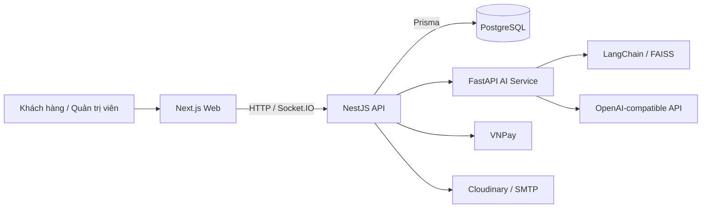

# JourniTrip
1. Giới thiệu

**JourniTrip** là hệ thống website du lịch thông minh, kết hợp nền tảng thương mại điện tử du lịch với các công nghệ AI nhằm hỗ trợ khách hàng khám phá, lựa chọn và đặt tour phù hợp với nhu cầu cá nhân. Hệ thống đồng thời cung cấp công cụ quản trị phục vụ hoạt động kinh doanh và vận hành tour.

Dự án được phát triển theo kiến trúc monorepo với npm Workspaces và Turborepo, bao gồm ba ứng dụng chính: Web, API nghiệp vụ và dịch vụ AI độc lập, cùng các thư viện dùng chung.

2. Tính năng nổi bật

### Khách hàng

- Tìm kiếm, lọc tour theo nhu cầu; xem lịch trình, lịch khởi hành, giá, điểm đón, dịch vụ và đánh giá.
- Lưu tour yêu thích, đặt tour, lựa chọn dịch vụ bổ sung và áp dụng voucher.
- Thanh toán trực tuyến qua VNPay và theo dõi đơn đặt tour.
- Đăng ký, đăng nhập, xác minh email, đăng nhập Google, quản lý hồ sơ, hạng thành viên và ví quyền lợi.
- Trao đổi trực tiếp với nhân viên thông qua Socket.IO.

### Trí tuệ nhân tạo (AI)

| Tính năng | Vai trò |
| --- | --- |
| AI Chatbot | Hỗ trợ tư vấn và giải đáp thắc mắc về tour du lịch. |
| AI Recommendation | Gợi ý tour phù hợp với nhu cầu của khách hàng. |
| AI Tour Comparison | Hỗ trợ phân tích và so sánh các lựa chọn tour. |
| Visual Search | Hỗ trợ tìm kiếm bằng hình ảnh. |
| AI Virtual Try-on | Cho phép thử trang phục bằng công nghệ tạo ảnh AI. |

### Quản trị và vận hành

- Quản lý tour, lịch khởi hành, đơn đặt tour và khách hàng.
- Quản lý nhân sự, phân công chuyến đi.
- Quản lý địa điểm, danh mục dịch vụ, bài viết, banner và chương trình ưu đãi.
- Theo dõi thống kê phục vụ quản trị.

> Các tính năng tích hợp yêu cầu cấu hình dịch vụ tương ứng trong môi trường chạy.

## 3. Công nghệ sử dụng

| Thành phần | Công nghệ |
| --- | --- |
| Website | Next.js 15, React 19, TypeScript, Tailwind CSS 4 |
| API | NestJS 11, JWT, Socket.IO |
| Cơ sở dữ liệu | PostgreSQL, Prisma 6 |
| AI | Python, FastAPI, LangChain, FAISS, API tương thích OpenAI |
| Tích hợp | Google OAuth, Google Maps, Cloudinary, SMTP, VNPay |
| Quản lý monorepo | npm Workspaces, Turborepo |

## 4. Kiến trúc và cấu trúc dự án



*Sơ đồ tổng quan các thành phần, minh họa từ mô tả kiến trúc của dự án.*

### Cấu trúc thư mục

```text
.
├── apps/
│   ├── web/                 # Website khách hàng và trang quản trị
│   ├── api/                 # API nghiệp vụ NestJS
│   └── ai/                  # FastAPI, chỉ mục tìm kiếm và kiểm thử Python
├── packages/
│   ├── database/            # Prisma schema, migration và client dùng chung
│   └── shared/              # Kiểu dữ liệu và hợp đồng dùng chung
├── .env.example             # Mẫu cấu hình môi trường
├── package.json             # Workspaces và các lệnh tại thư mục gốc
└── turbo.json               # Cấu hình tác vụ Turborepo
```

## 5. Yêu cầu hệ thống

- Node.js 22 LTS hoặc mới hơn.
- npm 11.5.2 theo trường `packageManager` trong `package.json`.
- Python 3.11 trở lên, có `pip` và `venv`, để chạy dịch vụ AI.
- PostgreSQL đang chạy và một database dành cho dự án.

Tất cả lệnh trong hướng dẫn được thực hiện tại thư mục gốc repository, sử dụng PowerShell.

## 6. Hướng dẫn cài đặt và khởi chạy

### Bước 1 — Cài đặt thư viện và tạo cấu hình

```powershell
npm install
if (-not (Test-Path .env)) { Copy-Item .env.example .env }
```

Nếu đã có `.env`, giữ lại cấu hình hiện tại. Chỉnh tối thiểu `DATABASE_URL` để kết nối PostgreSQL và thay `JWT_SECRET` bằng secret riêng. Cập nhật các URL nếu không dùng địa chỉ mặc định.

Web, API, Prisma và dịch vụ AI dùng chung `.env` ở gốc. Không cần tạo `.env` hoặc `.env.local` trong từng workspace. Biến đã đặt trong shell hoặc môi trường triển khai được ưu tiên hơn giá trị trong file.

### Bước 2 — Khởi tạo cơ sở dữ liệu phát triển

Tạo một database trống trong PostgreSQL, cập nhật `DATABASE_URL`, rồi chạy:

```powershell
npm run db:generate
npm run db:push
npm run build --workspace=shared
npm run build --workspace=database
```

`db:push` đồng bộ cấu trúc theo `packages/database/prisma/schema.prisma`; lệnh này không tạo dữ liệu mẫu. Hai bước build tạo các package dùng chung trước khi chạy riêng ứng dụng hoặc kiểm tra kiểu dữ liệu.

**Với database đã có dữ liệu:** kiểm tra schema, lịch sử migration và các bước chuyển đổi dữ liệu trước khi cập nhật. Các file SQL nằm trong `packages/database/prisma/migrations/`. Không dùng `db:push` thay cho migration có bước backfill dữ liệu; sao lưu trước khi thay đổi cấu trúc database đang sử dụng.

### Bước 3 — Thiết lập dịch vụ AI

```powershell
npm run setup --workspace=ai
```

Lệnh tạo môi trường ảo tại `apps/ai/.venv` và cài thư viện trong `apps/ai/requirements.txt`. Nếu cần chỉ định Python khi tạo môi trường:

```powershell
$env:AI_PYTHON = "C:\duong-dan\python.exe"
npm run setup --workspace=ai
```

Điền `OPENAI_API_KEY`, `OPENAI_BASE_URL` và các model phù hợp với nhà cung cấp bạn sử dụng. Điền giá trị thực tế vào `.env` tại thư mục gốc, giữ `.env.example` làm mẫu cấu hình.

### Bước 4 — Khởi chạy hệ thống

```powershell
npm run dev
```

Lệnh chạy web, API, dịch vụ AI và các package ở chế độ phát triển. Có thể chạy riêng trong các terminal:

```powershell
npm run dev:web
npm run dev:api
npm run dev:ai
```

| Dịch vụ | Địa chỉ mặc định |
| --- | --- |
| Website | http://localhost:3000 |
| Đăng nhập quản trị | http://localhost:3000/admin/login |
| API nghiệp vụ | http://localhost:4000 |
| Kiểm tra dịch vụ AI | http://localhost:8000/health |
| Tài liệu FastAPI | http://localhost:8000/docs |

Web chuyển các yêu cầu HTTP `/api/*` sang NestJS qua `API_INTERNAL_URL`. Kết nối Socket.IO sử dụng địa chỉ API công khai đã cấu hình cho trình duyệt.

## 7. Cấu hình biến môi trường

Xem cấu hình cơ bản tại [`.env.example`](.env.example).

| Nhóm | Biến môi trường |
| --- | --- |
| PostgreSQL | `DATABASE_URL` |
| Xác thực | `JWT_SECRET`, `JWT_EXPIRES_IN` |
| API và website | `API_HOST`, `API_PORT`, `API_INTERNAL_URL`, `API_PUBLIC_URL`, `FRONTEND_PUBLIC_URL`, `CORS_ORIGINS` |
| API phía trình duyệt | `NEXT_PUBLIC_API_BASE_URL`, `NEXT_PUBLIC_API_URL` |
| Google | `GOOGLE_CLIENT_ID`, `NEXT_PUBLIC_GOOGLE_CLIENT_ID`, `NEXT_PUBLIC_GOOGLE_MAPS_API_KEY` |
| Lưu ảnh | `CLOUDINARY_NAME`, `CLOUDINARY_KEY`, `CLOUDINARY_SECRET` |
| Email | `MAIL_HOST`, `MAIL_PORT`, `MAIL_SECURE`, `MAIL_USER`, `MAIL_PASS`, `MAIL_FROM_EMAIL`, `MAIL_FROM_NAME` |
| Thanh toán | `VNP_TMN_CODE`, `VNP_HASH_SECRET`, `VNP_PAYMENT_URL`, `VNP_RETURN_URL`, `VNP_EXPIRE_MINUTES` |
| AI | `AI_HOST`, `AI_PORT`, `OPENAI_API_KEY`, `OPENAI_BASE_URL`, `OPENAI_CHAT_MODEL`, `OPENAI_EMBEDDING_MODEL` |

Một số luồng AI dùng thêm các biến chưa liệt kê đầy đủ trong `.env.example`:

- `AI_INTERNAL_URL`: địa chỉ FastAPI cho luồng chatbot được proxy qua NestJS.
- `AI_SERVICE_URL`: địa chỉ FastAPI cho luồng diễn giải yêu cầu, so sánh tour và thử trang phục.
- `AI_SERVICE_TOKEN`: token dùng chung giữa NestJS và FastAPI cho các endpoint nội bộ có xác thực.
- `OPENAI_TRYON_MODEL`: model tạo ảnh cho chức năng thử trang phục.

Khi chạy AI cùng máy, có thể đặt cả `AI_INTERNAL_URL` và `AI_SERVICE_URL` thành `http://127.0.0.1:8000`.

Các biến có tiền tố `NEXT_PUBLIC_` được đưa vào trình duyệt, chỉ chứa thông tin công khai. Không commit `.env` hoặc khóa dịch vụ. Khởi động lại ứng dụng sau khi sửa `.env`; với bản production, build lại web khi thay đổi biến `NEXT_PUBLIC_`.

VNPay mặc định dùng sandbox. Đăng ký URL IPN dạng `<FRONTEND_PUBLIC_URL>/api/payment/vnpay-ipn` với VNPay và cấu hình URL trả về tương ứng.

## 8. Danh sách lệnh phát triển

| Lệnh | Mục đích |
| --- | --- |
| `npm run dev` | Chạy toàn bộ workspace ở chế độ phát triển |
| `npm run build` | Build các workspace có tác vụ build |
| `npm run typecheck` | Kiểm tra kiểu TypeScript |
| `npm run db:generate` | Sinh lại Prisma Client sau khi sửa schema |
| `npm run db:push` | Đồng bộ schema cho database phát triển |
| `npm run ai:index` | Tạo chỉ mục FAISS từ dữ liệu tour |
| `npm run test --workspace=ai` | Chạy bộ kiểm thử Python của dịch vụ AI |

Trước khi kiểm tra TypeScript trên máy mới, chạy `db:generate` và build `shared`, `database` theo hướng dẫn cài đặt. Bộ kiểm thử Python cần môi trường AI đã được cài.

## 9. Build và chạy ứng dụng

```powershell
npm run build
```

Sau khi build thành công, chạy mỗi dịch vụ trong một terminal hoặc trình quản lý tiến trình:

```powershell
# Website
npm run start --workspace=web

# API NestJS
node apps/api/dist/main.js

# Dịch vụ AI
npm run start --workspace=ai
```

`npm run build` build các workspace TypeScript/Next.js; dependency Python vẫn được cài bằng bước setup AI. Dừng các tiến trình dev trước khi dùng lại cùng cổng.
